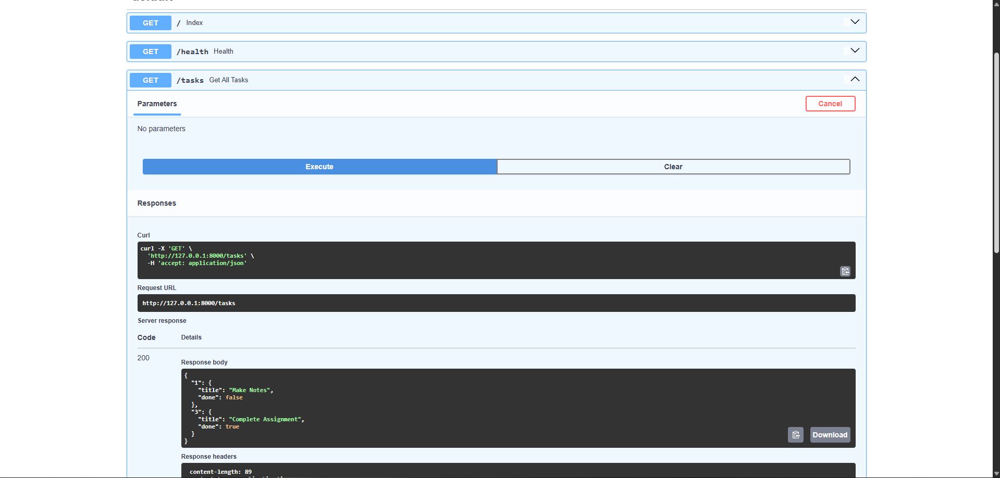

# Task API: FastAPI + Postgres + Docker

A CRUD API for managing a to-do list, built with FastAPI. Storage evolved over three assignments:

| Version | Storage | Where |
|---|---|---|
| A1 | In-memory dict | resets on restart |
| A2 | SQLite file (`tasks.db`) | local file |
| A3 (current) | Postgres in Docker | named volume, survives restarts |

## What this is

Each task has:
- `id` (number): assigned automatically by the database
- `title` (text): required, must not be blank
- `done` (true/false): defaults to `false`

## How to run it

Requirements: Docker Desktop (running).

```powershell
Copy-Item .env.example .env      # then edit .env and set a real password
docker compose up --build
```

The API runs at `http://localhost:8000`. Interactive Swagger docs are at `http://localhost:8000/docs`.

Note: `POSTGRES_PASSWORD` and the password inside `DATABASE_URL` in `.env` must match. Use letters and digits only, since characters like `@`, `:` or `/` break the connection URL.

To run uvicorn on your own machine instead (for development):

```powershell
docker compose up -d db
pip install -r requirements.txt
uvicorn myapi:app --reload
```

`.env` uses `localhost` for this case.

## Endpoints

| Method | Path | Description |
|--------|------|-------------|
| GET | `/` | API info (name, version, storage, endpoints) |
| GET | `/health` | Health check, returns `{"status": "ok"}` |
| GET | `/tasks` | List all tasks |
| GET | `/tasks/{id}` | Get a single task by ID |
| POST | `/tasks` | Create a new task (title is trimmed; blank gives 400) |
| PUT | `/tasks/{id}` | Update `title` and/or `done` (partial update) |
| DELETE | `/tasks/{id}` | Delete a task (204, or 404 if missing) |

Status codes: `201` on create, `200` on read/update, `204` on delete, `404` for missing tasks, `400`/`422` for invalid input.

## Example request

```bash
curl.exe -i http://localhost:8000/tasks
```

```
HTTP/1.1 200 OK
date: Sat, 29 Aug 2026 12:26:35 GMT
server: uvicorn
content-length: 131
content-type: application/json
```

On PowerShell, `Invoke-RestMethod` handles JSON quoting more reliably than `curl.exe`:

```powershell
Invoke-RestMethod -Method Post -Uri http://localhost:8000/tasks -ContentType "application/json" -Body '{"title":"example"}'
```

## Swagger UI



## Project layout

```
myapi.py             routes + Pydantic models (HTTP concerns only)
storage.py           all database code (psycopg)
db/init.sql          schema + seed rows, run by Postgres on first start
Dockerfile           builds the app image
docker-compose.yml   app + db, started together
.env.example         committed placeholders
.env                 real values (gitignored, excluded from the image)
```

## Configuration

- `.env` holds the real values. It is gitignored and excluded from the image by `.dockerignore`.
- `.env.example` is committed and holds placeholders.
- Inside Compose, `DATABASE_URL` is overridden to use host `db`. `localhost` inside the app container would point at the app container itself, not at Postgres. Compose makes each service name a hostname on a shared network.

## What changed in A3 (honest account)

A2's routes called `sqlite3` directly, so "switch storage" was not yet a one-file change. I did it in two steps:

1. **Refactor (still SQLite):** moved all SQL into `storage.py` (`list_tasks`, `get_task`, `create_task`, `update_task`, `delete_task`). Routes now handle only HTTP concerns (validation, status codes) and call `storage.*`.
2. **Swap to Postgres:** rewrote `storage.py` with `psycopg` 3. The route handlers and Pydantic models were not modified in this step.

Other changes, for completeness:

- `myapi.py`: removed the `init_db()` call (schema and seed now live in `db/init.sql`) and changed `"storage": "SQLite"` to `"Postgres"` in `/`.
- Added `db/init.sql`, `Dockerfile`, `.dockerignore`, `docker-compose.yml`, `.env.example`.
- Replaced `requirements.txt` with a minimal dependency list. The old one was a Windows `pip freeze` that lacked `psycopg` and `python-dotenv`.
- Added `.env` and `tasks.db` to `.gitignore`. `tasks.db` is no longer used.

Behavior differences from A2:

- Seeding runs only on the first start of an empty volume (via `/docker-entrypoint-initdb.d/`). A2 reseeded whenever the table was empty.
- `done` is a native Postgres `BOOLEAN`, so the `bool(row['done'])` conversion is gone.
- `update_task` is one `UPDATE ... COALESCE(...) RETURNING *` statement instead of SELECT-then-UPDATE. The route validates the title before calling storage, so nothing is written on a 400.
- The `with` block commits on success, rolls back on error, and always closes the connection. This fixed connection leaks on A2's 404 paths.

## Key design points

- **Why `depends_on` alone isn't enough:** it only waits for the db container to start, not for Postgres to accept connections. The db service has a `pg_isready` healthcheck, and the app uses `condition: service_healthy`.
- **Why a volume:** `taskdata` lives outside the container's writable layer, so removing the container keeps the data.
- **Why `init.sql` doesn't re-run:** Postgres only runs `/docker-entrypoint-initdb.d/` when the data directory is empty. To re-run it, remove the volume.
- **psycopg 3 vs psycopg2:** psycopg 3 is the actively developed version, with a cleaner API and native async support. psycopg2 is in maintenance mode.
- **Sync driver:** the routes are plain `def`, so FastAPI runs them in a threadpool and a blocking driver is fine. An async driver would need `await` through the whole stack.
- **SQL injection:** all queries use `%s` placeholders with parameters, never string formatting.

## Persistence proof

All commands run from the project folder.

**Test A: create rows, then restart both containers** (same containers, same volume)

```powershell
Invoke-RestMethod -Method Post -Uri http://localhost:8000/tasks -ContentType "application/json" -Body '{"title":"survive a restart"}'
docker compose restart
Invoke-RestMethod http://localhost:8000/tasks
```

Result: tasks 4 and 5 ("survive a restart") were still listed after the restart, next to the 3 seed rows.

**Test B: destroy the containers and network, keep the volume**

```powershell
docker compose down
docker compose up -d
Invoke-RestMethod http://localhost:8000/tasks
```

Result: brand-new containers, and rows 1-5 were all still there.

**Test C (negative control): delete the volume**

```powershell
docker compose down -v
docker compose up -d
Invoke-RestMethod http://localhost:8000/tasks
```

Result: only the 3 seed rows (ids 1-3) came back. The extra rows were gone and `init.sql` ran again on the fresh volume. This shows the volume, not caching or luck, holds the data.

## Exploring the database manually

```powershell
docker compose exec db psql -U app -d tasks -c "SELECT * FROM tasks;"
docker compose exec db psql -U app -d tasks -c "SELECT * FROM tasks WHERE done = true;"
docker compose exec db psql -U app -d tasks -c "SELECT COUNT(*) FROM tasks;"
```

Use the `POSTGRES_USER` and `POSTGRES_DB` values from your `.env`. Changes made directly in the database show up immediately in the API.

## Known limitations

- A new connection is opened per call. A pool (`psycopg_pool`) would be better under load.
- No migrations. Schema changes need a tool like Alembic, since `init.sql` runs only once.
- Dependencies in `requirements.txt` are unpinned.
- Sync driver only.
- Postgres port 5432 is published to the host for convenience. Remove the `ports:` entry for `db` if host access isn't needed.
- Stretch goals (Redis, `EXPLAIN ANALYZE`) are not done.